# Roteiro de Reprodução e Relatório Técnico — LSOR (Etapa 1)
## Rede Virtualizada com 8 VMs Clientes e 1 Gateway NAT

* **Disciplina:** Laboratório de Sistemas Operacionais e Redes (LSOR)
* **Turma:** `bsi-26-2` (2026.2)
* **Grupo:** Grupo 2
* **Data da Prática:** 20/10/2026
* **Integrantes e Usuários:**
  * Matheus Willian do Nascimento Oliveira (`matheus.nascimento`)
  * José Pedro Costa Duda (`jose.duda`)
  * Daniel Costa Alencar (`daniel.costa`)
  * Mateus Alves Santos (`mateus.santos`)
---

## 1. Visão Geral e Arquitetura do Projeto  

Este documento constitui o **roteiro de reprodução completo e tutorial passo a passo** para a criação, configuração e validação do ambiente virtualizado do **Grupo 2**. 

A arquitetura é composta por **9 Máquinas Virtuais (VMs)** rodando Ubuntu Server CLI (sem interface gráfica), distribuídas fisicamente entre **4 computadores do laboratório**:
* **1 Gateway NAT / Firewall (`g2-pc1-gw`):** Localizado no PC 1 físico, atuando como o ponto central de roteamento, tradução de endereços de rede (NAT/MASQUERADE) e controle de acesso.
* **8 VMs Clientes (`g2-pc1-vm1` a `g2-pc4-vm2`):** Distribuídas aos pares (2 por PC físico) nos PCs 1, 2, 3 e 4.

Toda a sub-rede privada do Grupo 2 (`192.168.26.32/28`) está isolada logicamente sobre o mesmo switch físico do laboratório. O tráfego de saída das máquinas clientes para a rede externa do laboratório (`172.20.20.0/22`) e para a internet passa obrigatoriamente pelo Gateway.

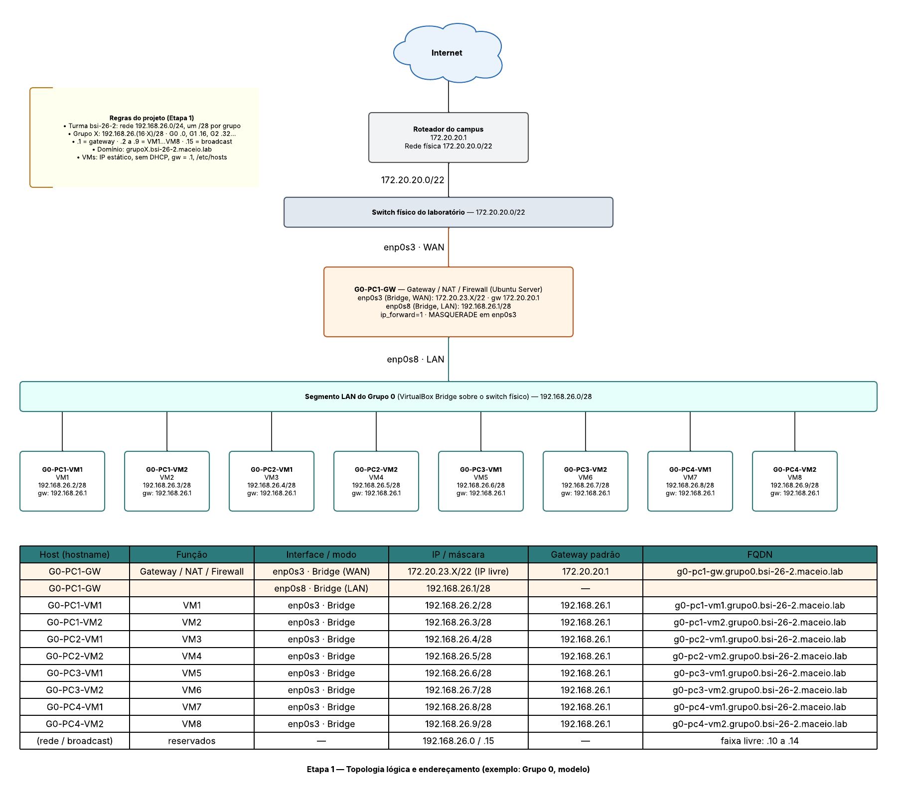
*Figura 1: Topologia lógica de rede e esquema de endereçamento da sub-rede `192.168.26.32/28` do Grupo 2.*

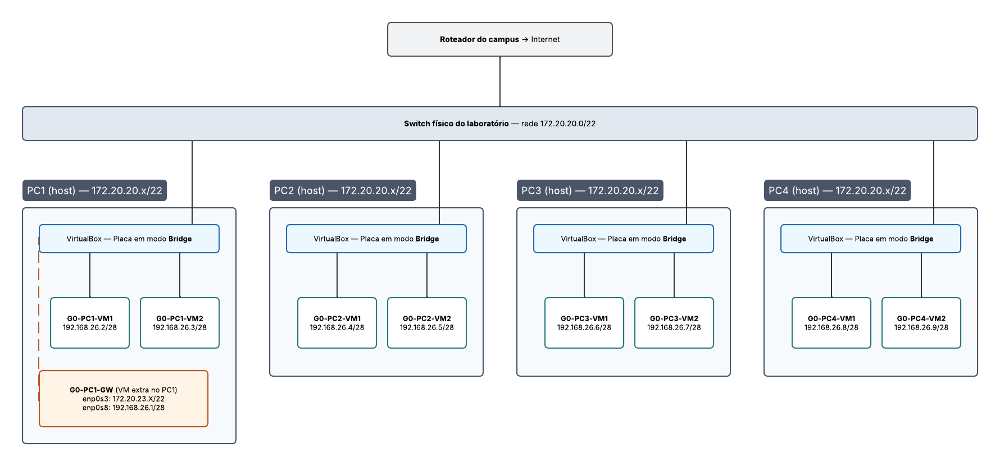
*Figura 2: Distribuição física das 9 VMs pelos 4 computadores do laboratório interconectados via switch.*

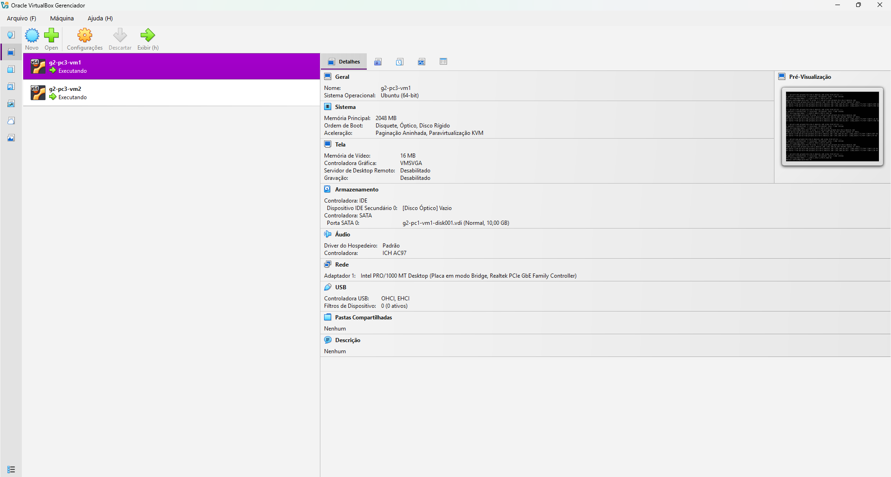
*Figura 3: Execução simultânea das máquinas virtuais no hipervisor VirtualBox do PC3 (`g2-pc3-vm1` e `g2-pc3-vm2`).*

---

## 2. Tabela Oficial de Mapeamento e Endereçamento IP

A sub-rede do Grupo 2 utiliza o bloco CIDR `192.168.26.32/28` (Máscara: `255.255.255.240`, Broadcast: `192.168.26.47`).

| Host (VM) | PC Físico | Interface | Modo VirtualBox | Endereço IP / Máscara | Gateway Padrão | FQDN Oficial | Apelido (`/etc/hosts`) |
| :--- | :--- | :--- | :--- | :--- | :--- | :--- | :--- |
| **`g2-pc1-gw`** | PC 1 | `enp0s3` (WAN)<br>`enp0s8` (LAN) | Bridge Adapter<br>Bridge Adapter | `172.20.23.60/22`<br>`192.168.26.33/28` | `172.20.20.1`<br>— | `g2-pc1-gw.grupo2.bsi-26-2.maceio.lab` | `g2-pc1-gw` |
| **`g2-pc1-vm1`** | PC 1 | `enp0s3` (LAN) | Bridge Adapter | `192.168.26.34/28` | `192.168.26.33` | `g2-pc1-vm1.grupo2.bsi-26-2.maceio.lab` | `g2-pc1-vm1` |
| **`g2-pc1-vm2`** | PC 1 | `enp0s3` (LAN) | Bridge Adapter | `192.168.26.35/28` | `192.168.26.33` | `g2-pc1-vm2.grupo2.bsi-26-2.maceio.lab` | `g2-pc1-vm2` |
| **`g2-pc2-vm1`** | PC 2 | `enp0s3` (LAN) | Bridge Adapter | `192.168.26.36/28` | `192.168.26.33` | `g2-pc2-vm1.grupo2.bsi-26-2.maceio.lab` | `g2-pc2-vm1` |
| **`g2-pc2-vm2`** | PC 2 | `enp0s3` (LAN) | Bridge Adapter | `192.168.26.37/28` | `192.168.26.33` | `g2-pc2-vm2.grupo2.bsi-26-2.maceio.lab` | `g2-pc2-vm2` |
| **`g2-pc3-vm1`** | PC 3 | `enp0s3` (LAN) | Bridge Adapter | `192.168.26.38/28` | `192.168.26.33` | `g2-pc3-vm1.grupo2.bsi-26-2.maceio.lab` | `g2-pc3-vm1` |
| **`g2-pc3-vm2`** | PC 3 | `enp0s3` (LAN) | Bridge Adapter | `192.168.26.39/28` | `192.168.26.33` | `g2-pc3-vm2.grupo2.bsi-26-2.maceio.lab` | `g2-pc3-vm2` |
| **`g2-pc4-vm1`** | PC 4 | `enp0s3` (LAN) | Bridge Adapter | `192.168.26.40/28` | `192.168.26.33` | `g2-pc4-vm1.grupo2.bsi-26-2.maceio.lab` | `g2-pc4-vm1` |
| **`g2-pc4-vm2`** | PC 4 | `enp0s3` (LAN) | Bridge Adapter | `192.168.26.41/28` | `192.168.26.33` | `g2-pc4-vm2.grupo2.bsi-26-2.maceio.lab` | `g2-pc4-vm2` |

---

## 3. Passo a Passo de Implementação

### 3.1. Instalação da VM Base e Criação de Usuários em Lote

Para evitar repetir o processo de instalação do sistema operacional 9 vezes, instalou-se uma **VM Modelo Base** rodando Ubuntu Server LTS no VirtualBox.


*Figura 4: Criação e especificação de hardware da máquina virtual base no VirtualBox.*

Antes de realizar a clonagem da máquina base, executou-se um script em malha `for` para criar as contas de usuário de todos os integrantes do grupo com shell `/bin/bash` e privilégios administrativos no grupo `sudo`:

```bash
# Script de criação de usuários em lote (executado na VM Modelo)
for u in matheus.nascimento jose.duda daniel.costa mateus.santos; do
  sudo useradd -m -s /bin/bash "$u"
  sudo usermod -aG sudo "$u"
  echo "$u:senha123" | sudo chpasswd
done

# Verificação das contas criadas
getent passwd matheus.nascimento jose.duda daniel.costa mateus.santos
```

  
*Figura 5: Confirmação das contas dos integrantes no arquivo `/etc/passwd` do Gateway e das VMs.*

---

### 3.2. Mapeamento Estático de Resolução de Nomes (`/etc/hosts`)

Ainda na VM Modelo Base, configurou-se o arquivo `/etc/hosts` com o mapeamento completo das 9 máquinas do Grupo 2. Dessa forma, todos os clones herdaram a tabela de resolução local sem necessidade de servidor DNS local.

```bash
# Edição do arquivo /etc/hosts
sudo nano /etc/hosts
```

O conteúdo gravado no arquivo `/etc/hosts` de todas as VMs foi:

```text
127.0.0.1       localhost
127.0.1.1       g2-pc1-gw.grupo2.bsi-26-2.maceio.lab g2-pc1-gw

# Tabela Mestre do Grupo 2 - bsi-26-2
192.168.26.33   g2-pc1-gw.grupo2.bsi-26-2.maceio.lab     g2-pc1-gw
192.168.26.34   g2-pc1-vm1.grupo2.bsi-26-2.maceio.lab    g2-pc1-vm1
192.168.26.35   g2-pc1-vm2.grupo2.bsi-26-2.maceio.lab    g2-pc1-vm2
192.168.26.36   g2-pc2-vm1.grupo2.bsi-26-2.maceio.lab    g2-pc2-vm1
192.168.26.37   g2-pc2-vm2.grupo2.bsi-26-2.maceio.lab    g2-pc2-vm2
192.168.26.38   g2-pc3-vm1.grupo2.bsi-26-2.maceio.lab    g2-pc3-vm1
192.168.26.39   g2-pc3-vm2.grupo2.bsi-26-2.maceio.lab    g2-pc3-vm2
192.168.26.40   g2-pc4-vm1.grupo2.bsi-26-2.maceio.lab    g2-pc4-vm1
192.168.26.41   g2-pc4-vm2.grupo2.bsi-26-2.maceio.lab    g2-pc4-vm2
```

  
*Figura 6: Visualização do arquivo `/etc/hosts` configurado com FQDN e nomes curtos das VMs.*

---

### 3.3. Configuração dos Adaptadores de Rede no VirtualBox e Clonagem

As 9 máquinas foram clonadas a partir da VM Base. Em **todos os processos de clonagem e importação**, selecionou-se obrigatoriamente a opção **"Gerar novos endereços MAC para todas as placas de rede"** para evitar conflitos de ARP no switch do laboratório.

#### Configuração das Placas do Gateway (`g2-pc1-gw`):
* **Adaptador 1 (`enp0s3` - WAN):** Modo **Placa em Ponte (Bridge Adapter)** conectado à placa física do PC1. **Modo Promíscuo: Permitir Tudo**.
* **Adaptador 2 (`enp0s8` - LAN):** Modo **Placa em Ponte (Bridge Adapter)** conectado à placa física do PC1. **Modo Promíscuo: Permitir Tudo**.

  
*Figura 7: Configuração da interface WAN (`enp0s3`) do Gateway em Placa em Ponte.*

  
*Figura 8: Configuração da interface LAN (`enp0s8`) do Gateway em Placa em Ponte.*

#### Configuração das Placas das VMs Clientes (`g2-pc1-vm1` a `g2-pc4-vm2`):
Cada VM cliente possui apenas **1 placa de rede (`enp0s3`)** em modo **Placa em Ponte (Bridge Adapter)** associada à interface física do computador onde está hospedada, permitindo a comunicação via switch físico com a LAN do Gateway (`192.168.26.33`).

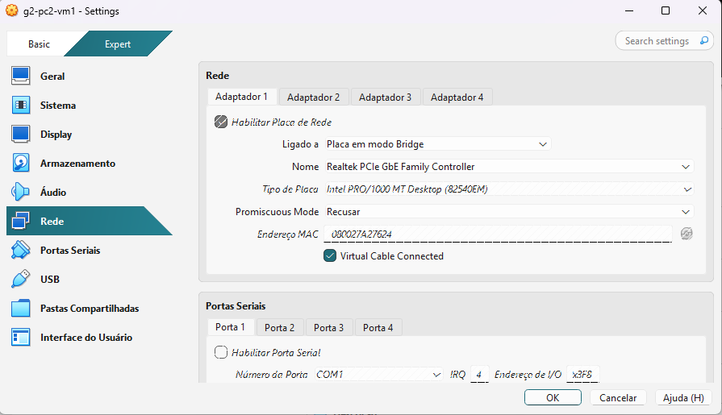  
*Figura 9: Placa de rede em modo Bridge na VM `g2-pc2-vm1`.*

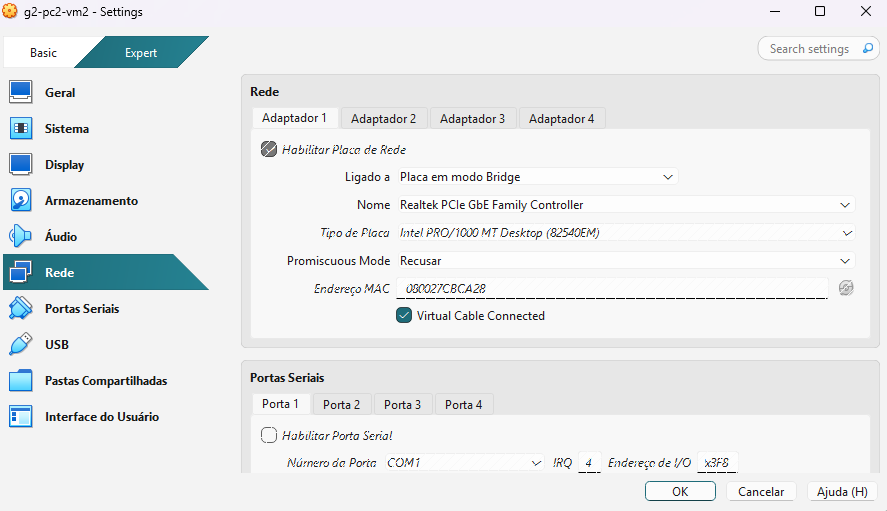  
*Figura 10: Placa de rede em modo Bridge na VM `g2-pc2-vm2`.*

---

### 3.4. Definição do Hostname Oficial (FQDN)

Em cada máquina virtual criada, definiu-se o nome FQDN completo utilizando o utilitário `hostnamectl`:

```bash
# Exemplo executado no Gateway
sudo hostnamectl set-hostname g2-pc1-gw.grupo2.bsi-26-2.maceio.lab

# Exemplo executado na VM1 do PC2
sudo hostnamectl set-hostname g2-pc2-vm1.grupo2.bsi-26-2.maceio.lab

# Verificação do FQDN
hostname
cat /etc/hostname
```

---

### 3.5. Configuração do Netplan para Endereçamento Estático

#### A. Netplan do Gateway (`g2-pc1-gw`)
Arquivo `/etc/netplan/00-installer-config.yaml` com duas interfaces configuradas (WAN estática na rede do laboratório e LAN estática no IP `.33`):

```yaml
network:
  version: 2
  renderer: networkd
  ethernets:
    enp0s3:            # Interface WAN (Rede do Laboratório)
      dhcp4: false
      addresses:
        - 172.20.23.60/22
      routes:
        - to: default
          via: 172.20.20.1
      nameservers:
        addresses: [172.20.20.1, 1.1.1.1, 8.8.8.8]
    enp0s8:            # Interface LAN (Sub-rede do Grupo 2)
      dhcp4: false
      addresses:
        - 192.168.26.33/28
```

  
*Figura 11: Configuração do Netplan no Gateway com interfaces WAN (`enp0s3`) e LAN (`enp0s8`).*

#### B. Netplan das VMs Clientes (`g2-pc1-vm1` a `g2-pc4-vm2`)
Arquivo de rede das VMs clientes direcionando a rota padrão (`default via`) para a interface LAN do Gateway (`192.168.26.33`):

```yaml
network:
  version: 2
  renderer: networkd
  ethernets:
    enp0s3:            # Interface LAN
      dhcp4: false
      addresses:
        - 192.168.26.36/28   # (Endereço específico de cada VM)
      routes:
        - to: default
          via: 192.168.26.33  # IP do Gateway
      nameservers:
        addresses: [172.20.20.1, 1.1.1.1, 8.8.8.8]
```

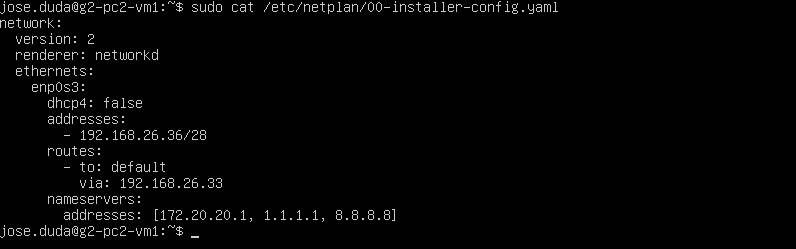  
*Figura 12: Arquivo de rede Netplan na VM `g2-pc2-vm1` (`192.168.26.36/28`).*

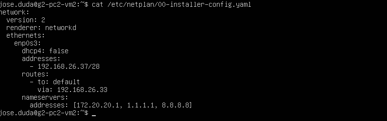  
*Figura 13: Arquivo de rede Netplan na VM `g2-pc2-vm2` (`192.168.26.37/28`).*

  
*Figura 14: Confirmação do Netplan e endereço IP `.38` na VM `g2-pc3-vm1`.*

  
*Figura 15: Confirmação do Netplan e endereço IP `.39` na VM `g2-pc3-vm2`.*

Para aplicar as novas configurações em qualquer máquina:
```bash
sudo netplan apply
```

---

### 3.6. Configuração do Roteamento e Regras de NAT/IPTables no Gateway

Para permitir que o Gateway repasse o tráfego da LAN para a WAN e realize a Tradução de Endereços de Rede (NAT), executaram-se os seguintes passos no Gateway (`g2-pc1-gw`):

```bash
# 1. Habilitação persistente do repasse de pacotes IPv4 no kernel
sudo sysctl -w net.ipv4.ip_forward=1
echo "net.ipv4.ip_forward=1" | sudo tee /etc/sysctl.d/99-ipforward.conf

# 2. Configuração da regra de Mascaramento (MASQUERADE) na interface WAN (enp0s3)
sudo iptables -t nat -A POSTROUTING -o enp0s3 -j MASQUERADE

# 3. Regras de permissão de encaminhamento (FORWARD) de pacotes entre LAN e WAN
sudo iptables -A FORWARD -i enp0s8 -o enp0s3 -j ACCEPT
sudo iptables -A FORWARD -i enp0s3 -o enp0s8 -m conntrack --ctstate ESTABLISHED,RELATED -j ACCEPT

# 4. Salvar as regras de forma permanente no sistema
sudo netfilter-persistent save || sudo iptables-persistent save
```

#### Verificação das Regras de NAT e Firewall Ativas:

```bash
# Listar regras da tabela NAT
sudo iptables -t nat -L -n -v
```

  
*Figura 16: Confirmação da regra MASQUERADE ativa na tabela NAT do IPTables no Gateway.*

```bash
# Listar regras de encaminhamento da tabela FILTER
sudo iptables -L FORWARD -n -v
```

  
*Figura 17: Exibição das cadeias e regras de filtro ativas no IPTables do Gateway.*

---

## 4. Bateria Completa de Testes e Evidências de Funcionamento

### 4.1. Testes de Conectividade Remota via SSH e PuTTY

O serviço OpenSSH foi validado em múltiplos cenários de acesso remoto para garantir o gerenciamento das máquinas.

#### A. Acesso SSH via PuTTY (Do PC Físico do Laboratório para o IP Público do Gateway)
Do sistema host Windows do laboratório, abriu-se o PuTTY conectando ao IP público da interface WAN do Gateway (`172.20.23.60` na porta 22).

  
*Figura 18: Tela do PuTTY configurada para conexão SSH na interface WAN do Gateway (`172.20.23.60`).*

  
*Figura 19: Autenticação SSH realizada com sucesso no Gateway através do PuTTY.*

#### B. Conexão SSH Encadeada (Do Gateway para as VMs Clientes Internas)
A partir do terminal do Gateway, realizou-se o acesso SSH para as máquinas clientes da rede privada:

```bash
# Conexão SSH do Gateway para a VM1 do PC2
ssh matheus.nascimento@g2-pc2-vm1
```

  
*Figura 20: Sessão SSH estabelecida a partir do Gateway na VM `g2-pc2-vm1` (`192.168.26.36`).*

#### C. Acesso SSH Direto Entre VMs Clientes
Testes de SSH direto entre máquinas clientes conectadas em diferentes PCs do laboratório:

```bash
# Executado na VM1 do PC2 acessando a VM2 do PC2
ssh matheus.nascimento@g2-pc2-vm2
```

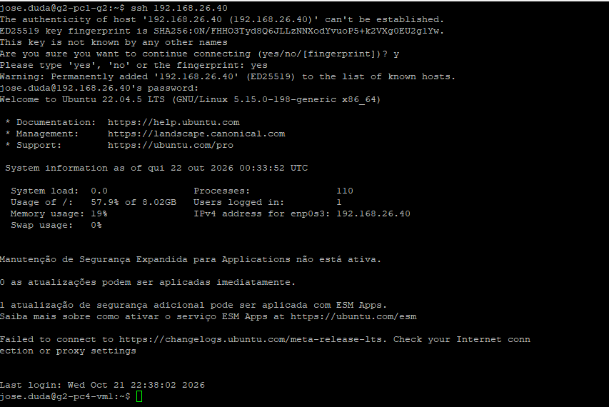  
*Figura 21: Conexão SSH bem-sucedida entre `g2-pc2-vm1` e `g2-pc2-vm2`.*

  
*Figura 22: Terminal local/SSH da maquina `g2-pc3-vm1`.*

  
*Figura 23: Terminal local/SSH da máquina `g2-pc3-vm2`.*

---

### 4.2. Testes de Conectividade ICMP e Resolução de Nomes Local (`ping`)

Para validar a comunicação interna da rede privada do grupo (`192.168.26.32/28`), testaram-se pings entre os hosts por IP, nome curto e FQDN.

#### A. Ping das VMs para o Gateway (`192.168.26.33`)
```bash
# Teste executado da VM1 do PC3 para a interface LAN do Gateway
ping -c 4 192.168.26.33
```

  
*Figura 24: Teste de ping sem perda de pacotes a partir da VM `g2-pc3-vm1` para o Gateway.*

#### B. Ping por Nome Curto e FQDN Entre Clientes
```bash
# Teste executado na VM1 do PC2
ping -c 2 g2-pc1-gw
ping -c 2 g2-pc2-vm2.grupo2.bsi-26-2.maceio.lab
```

  
*Figura 25: Resolução de nomes por `/etc/hosts` e pings bem-sucedidos na VM `g2-pc2-vm1`.*

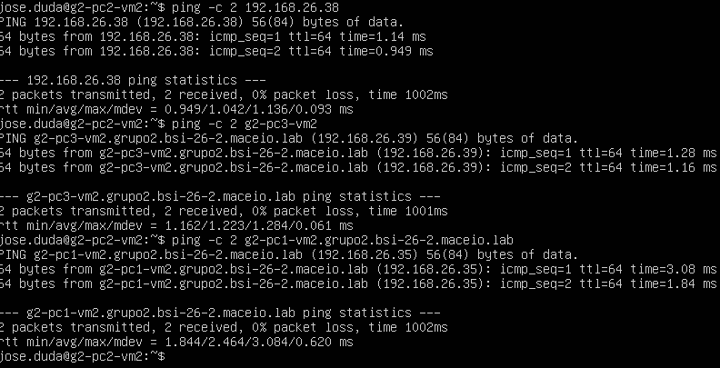  
*Figura 26: Testes de conectividade ICMP e resolução local na VM `g2-pc2-vm2`.*

  
*Figura 27: Comunicação ICMP entre `g2-pc3-vm1` e outros hosts do grupo.*

  
*Figura 28: Comunicação ICMP entre `g2-pc3-vm2` e demais máquinas virtuais.*

  
*Figura 29: Verificação de resolução de nomes e conectividade de rede na máquina `g2-pc3-vm1`.*

---

### 4.3. Validação do Roteamento NAT e Saída para a Internet (`traceroute` e `ping`)

Para comprovar que todas as VMs clientes estão saindo para a internet através do Gateway do grupo (passando obrigatoriamente pela NAT), executaram-se testes de `traceroute` e `ping` para domínios e IPs externos.

#### Critério de Sucesso do Traceroute:
O **1º Salto (`hop 1`)** deve ser obrigatoriamente o IP da LAN do Gateway (`192.168.26.33`).
O **2º Salto (`hop 2`)** deve ser o IP do Roteador da Faculdade (`172.20.20.1`).

```bash
# Rastreamento de rota para domínios externos
traceroute google.com
traceroute 8.8.8.8
```

  
*Figura 30: Traceroute na VM `g2-pc1-vm1` mostrando o 1º salto em `192.168.26.33` (Gateway).*

  
*Figura 31: Traceroute na VM `g2-pc1-vm2` para o DNS `8.8.8.8` via Gateway.*

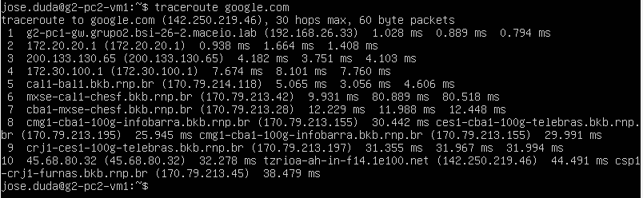  
*Figura 32: Traceroute para `google.com` executado na VM `g2-pc2-vm1`.*

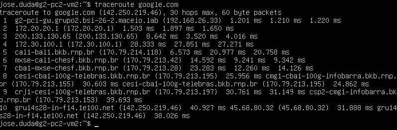  
*Figura 33: Traceroute para `google.com` executado na VM `g2-pc2-vm2`.*

  
*Figura 34: Rastreamento de rota e ping externo para a internet na VM `g2-pc3-vm1`.*

  
*Figura 35: Rastreamento de rota e ping externo para a internet na VM `g2-pc3-vm2`.*

---

## 5. Diagnóstico de Problemas Encontrados e Soluções Aplicadas

1. **Conflito de Endereços MAC no Switch do Laboratório:**
   * **Sintoma:** Máquinas apresentavam perda de pacotes e oscilação na tabela ARP ao tentar comunicar via rede em ponte.
   * **Causa:** Clones gerados no VirtualBox sem redefinir o endereço MAC herdaram a mesma interface de rede da VM Base.
   * **Solução:** No momento da clonagem e importação das VMs nos 4 PCs do laboratório, selecionou-se obrigatoriamente a opção *"Gerar novos endereços MAC para todas as placas de rede"*.

2. **Bloqueio de Pacotes em Modo Ponte no VirtualBox:**
   * **Sintoma:** O Gateway e as VMs clientes não conseguiam trocar pacotes ICMP através do switch físico.
   * **Causa:** O VirtualBox bloqueava tráfego com endereços MAC virtuais por padrão.
   * **Solução:** Em todas as placas em ponte (Bridge Adapters) do VirtualBox, alterou-se a opção **Modo Promíscuo** nas configurações avançadas para **"Permitir Tudo" (Allow All)**.

3. **Incapacidade das VMs Clientes Acessarem a Internet:**
   * **Sintoma:** As VMs clientes pingavam o Gateway (`192.168.26.33`), mas recebiam tempo limite ao tentar pingar `8.8.8.8` ou `google.com`.
   * **Causa:** O parâmetro de encaminhamento de pacotes (`ip_forward`) não estava habilitado no kernel do Gateway.
   * **Solução:** Executou-se `sudo sysctl -w net.ipv4.ip_forward=1` e inseriu-se a regra `iptables -t nat -A POSTROUTING -o enp0s3 -j MASQUERADE` na interface WAN do Gateway.

4. **Erro de Resolução de Nomes (`Temporary failure in name resolution`):**
   * **Sintoma:** O `ping 8.8.8.8` funcionava na VM cliente, mas o `ping google.com` falhava.
   * **Causa:** Ausência de servidores DNS externos válidos no arquivo `/etc/netplan/00-installer-config.yaml` da VM cliente.
   * **Solução:** Adicionaram-se os servidores DNS `172.20.20.1`, `1.1.1.1` e `8.8.8.8` na seção `nameservers` do Netplan e atualizou-se o serviço com `sudo netplan apply`.

---

## 6. Conclusão

A realização desta prática permitiu consolidar com êxito todos os objetivos propostos na disciplina de **Laboratório de Sistemas Operacionais e Redes (LSOR)**:

1. **Construção do Ambiente:** Foi implantada uma rede virtualizada composta por 9 máquinas virtuais Ubuntu Server distribuídas fisicamente entre 4 computadores do laboratório.
2. **Isolamento e Roteamento NAT:** O Gateway (`g2-pc1-gw`) desempenhou perfeitamente seu papel de isolar a sub-rede privada do grupo (`192.168.26.32/28`), provendo roteamento e mascaramento de IP (NAT/MASQUERADE) via IPTables.
3. **Acesso Remoto e Resolução de Nomes:** Todos os hosts foram integrados via SSH com contas de usuários individuais para os integrantes e resolução estática FQDN via `/etc/hosts`.
4. **Validação:** Todos os testes de conectividade local (`ping`), rastreamento de rota (`traceroute`) e acesso externo confirmaram o pleno funcionamento da topologia do **Grupo 2**.
